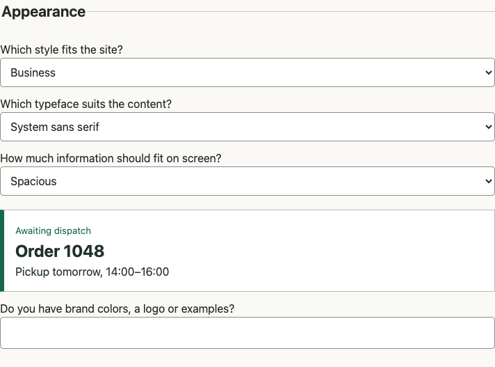

# HAP Compute Design Kit

Plan and build a standalone site or a frontend for an existing HAP application. The local planner turns decisions about the audience, access, content and appearance into a reusable brief for your coding agent.



<details>
<summary>Compare the three visual presets</summary>


</details>

## Quick start

You need Git and Node.js 18 or later.

```sh
git clone https://github.com/Asura3301/hap_compute_design_kit.git
cd hap_compute_design_kit
node skills/hap-compute-design/bin/hap-design.mjs new
```

Open the printed URL in your browser. Choose **Standalone website**, complete the brief and preview the screen plan. Download `design-brief.json` into your website project. Use **Reopen an existing brief** to revise it. The planner also imports briefs exported by version 0.2.

## Install the agent skill and CLI

Copy the whole skill folder into your agent's skills directory. For a project that uses `.agents/skills`, run the following from this clone after setting the project path.

```sh
PROJECT_DIR="/absolute/path/to/your-site"
mkdir -p "$PROJECT_DIR/.agents/skills"
cp -R skills/hap-compute-design "$PROJECT_DIR/.agents/skills/"
```

Open that project in your agent and ask it to “Use hap-compute-design with design-brief.json. Show me the screens and how we will test the primary task.” For a Compute project, install the official Compute skill using **Create Compute → Connect Other AI Tools** in your organization. [HAP Compute setup](https://help.mingdao.com/en/compute/#22-connect-other-ai-tools)

To make `hap-design` available on your PATH, run `npm install -g ./skills/hap-compute-design` from the clone. For local development use `npm link` from the skill directory. Checked builds are available as workflow artifacts in [GitHub Actions](https://github.com/Asura3301/hap_compute_design_kit/actions/workflows/cli.yml). For an archive installation, download the artifact from a successful run, unzip it and run `npm install -g ./hap-compute-design-0.3.1.tgz` using the filename in the artifact.

| Command | What it does |
| --- | --- |
| `hap-design new` | Creates a local planner |
| `hap-design styles` | Opens the planner link at the visual preview |
| `hap-design check design-brief.json` | Validates and prints the normalized brief as JSON |
| `hap-design scaffold BRIEF.json --template standalone\|dispatch --out NEW_DIRECTORY` | Creates a themed frontend starter |
| `hap-design apps --org ID --origin HTTPS_API_BASE` | Lists apps in the PAT owner's scope |
| `hap-design new --org ID --origin HTTPS_API_BASE` | Preloads the app picker from that list |

For app discovery, provide `HAP_PAT` through your local environment. Use the approved HTTPS API base URL for your organization. HAP Server deployments can include the documented `/api` suffix. The CLI sends the PAT to that origin. [App list API](https://apidoc.mingdao.com/docs/app/application-v3-get--v3-apps-list?auth=pat&version=v3) App names and IDs are included in the local planner. Keep that file on your machine. Website visitors sign in through the access policy configured for the deployed site.

## Build and preview a starter

```sh
hap-design scaffold design-brief.json --template standalone --out ./design-preview
```

Open `design-preview/public/index.html`. Use `--template dispatch` for a searchable queue with synthetic orders. Both starters apply the brief's preset, typeface and density. The brief remains the source for custom content, screens and access decisions.

To connect the queue to an existing HAP app, map its fields to your Compute server adapter and set the same-origin endpoint in the template. Follow the [Compute handoff](skills/hap-compute-design/references/compute.md) to configure access and publish the reviewed frontend. The browser tests exercise the contract using a fixture. Live PAT discovery, sign-in and deployment require access to a disposable HAP organization.

## Development

Run `npm test --prefix skills/hap-compute-design` to test the CLI. CI also runs Chromium tests and builds downloadable skill and npm archives with SHA256 checksums. The starter checks cover keyboard navigation, 360 px layout, axe accessibility rules and a 16 KiB local page payload budget. See the [changelog](CHANGELOG.md) for version history. See the [release plan](docs/ROADMAP.md) for packaging, visual checks and the live Compute acceptance scenarios.

[MIT license](LICENSE)
