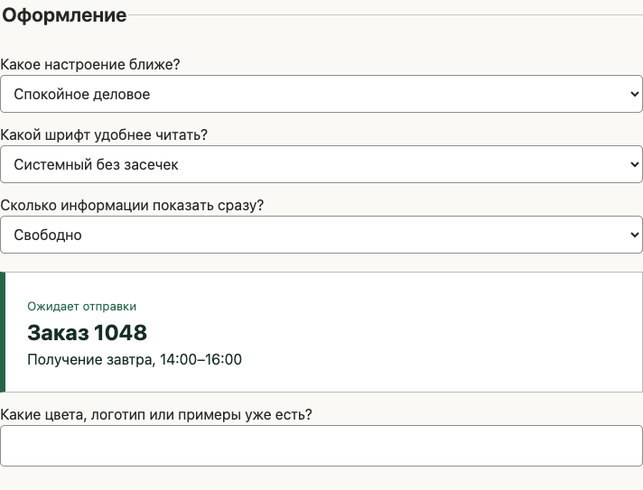

# HAP Compute Design Kit

Соберите бриф для сайта HAP Compute и передайте его coding agent. Мастер помогает выбрать аудиторию, источник данных, способ входа и оформление. Палитру, шрифт и плотность можно сравнить на одной и той же карточке заказа.


<details>
<summary>Посмотреть анимацию трёх вариантов оформления</summary>



</details>

## Попробовать за минуту

Понадобятся Git и Node.js 18 или новее. Для знакомства достаточно локального компьютера.

```sh
git clone https://github.com/Asura3301/hap_compute_design_kit.git
cd hap_compute_design_kit
node skills/hap-compute-design/bin/hap-design.mjs new
```

Откройте выведенную ссылку в браузере. Выберите «Самостоятельный сайт», заполните вопросы и нажмите «Скачать бриф проекта». Переместите полученный `design-brief.json` в проект сайта.

## Подключить skill к агенту

Скопируйте **весь каталог** `skills/hap-compute-design` в директорию навыков агента. Например, из корня этого репозитория для проекта, использующего `.agents/skills`, при первой установке выполните следующие команды, заменив путь своим.

```sh
PROJECT_DIR="/absolute/path/to/your-site"
mkdir -p "$PROJECT_DIR/.agents/skills"
cp -R skills/hap-compute-design "$PROJECT_DIR/.agents/skills/"
```

Откройте проект сайта в агенте и попросите: «Используй hap-compute-design и design-brief.json. Покажи план экранов для главной задачи пользователя». Для разработки и публикации в HAP Compute отдельно подключите официальный skill `hap-compute-app` через поддерживаемый вашей организацией способ установки.

## Короткие команды

Чтобы вызывать CLI из любой папки, выполните из корня клона:

```sh
(cd skills/hap-compute-design && npm link)
hap-design help
```

| Команда | Результат |
| --- | --- |
| `hap-design new` | Локальная ссылка на мастер нового проекта |
| `hap-design styles` | Мастер, открытый на выборе оформления |
| `hap-design apps --org ID --origin HTTPS_ORIGIN` | Список приложений, которыми владеет пользователь PAT |
| `hap-design new --org ID --origin HTTPS_ORIGIN` | Мастер с выбором из этого списка |

Для двух последних команд задайте `HAP_PAT` через локальное окружение. Подставьте ID организации и проверенный HTTPS-адрес её **API**, без пути и завершающего слеша. CLI отправляет PAT на указанный адрес. Временная страница хранит имена и ID приложений. Держите её на своём компьютере. Способ входа будущих посетителей выбирается отдельно в брифе.

## Состав версии 0.2

- [Инструкции агента](skills/hap-compute-design/SKILL.md) и [передача проекта HAP Compute](skills/hap-compute-design/references/compute.md).
- [HTML-шаблон очереди заказов](skills/hap-compute-design/assets/templates/index.html) и [базовые стили](skills/hap-compute-design/assets/components/ui.css).
- [План до версии 1.0](docs/ROADMAP.md) с критериями приёмки, интеграциями, GitHub CI и подготовкой релиза.

Мастер и экспорт брифа проверены в Chrome. Получение приложений проверено на тестовом ответе API. Проверка на реальном аккаунте и публикация тестового сайта в Compute входят в этап интеграции.

[Лицензия MIT](LICENSE)
